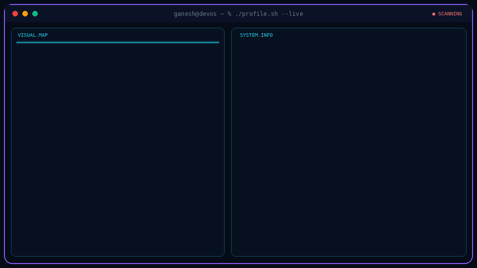
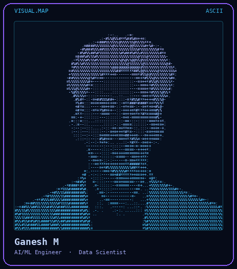

<!-- ============================== HEADER ============================== -->
<p align="center">
  
</p>

<p align="center">
  
</p>

<p align="center">
  
  
  
  
</p>

<p align="center">
  
</p>

<p align="center">
  <a href="#" target="_blank"></a>
  <a href="https://www.linkedin.com/in/ganesh-m-217b531b8/" target="_blank"></a>
  <a href="mailto:gganu8615@gmail.com"></a>
  <a href="https://github.com/Ganu0124" target="_blank"></a>
</p>

<p align="center">
  
  
  
</p>

<p align="center">
  
</p>

<!-- ============================== TERMINAL CARD ============================== -->
<p align="center">
  
</p>

<!-- ============================== DEMO ============================== -->
## 🎬 Portfolio Demo

<div align="center">
  
</div>

<p align="center">
  
</p>

<!-- ============================== ABOUT ============================== -->
## 🧬 About Me

<table>
<tr>
<td width="58%">

### Ganesh M — AI & Data Science Engineer

I'm pursuing an **MCA in Artificial Intelligence & Data Science** at ASAS, Mysore (Amrita Vishwa Vidyapeetham), building on a **BCA in Data Science**. My work centers on **Python, SQL, deep learning, and data pipelines**: turning raw data into decisions.

My flagship project is a **CNN system for cucumber growth stage detection**: a computer vision pipeline covering dataset curation, model design, training, evaluation, and agricultural deployment. I've also built **commodity price analytics** and **IoT wireless transmission prototypes**.

I take a **product-first approach**: careful with data quality, deliberate about model architecture, focused on real outcomes. My interests span **computer vision**, **predictive analytics**, **full stack development**, **databases**, and **IoT**.

</td>
<td width="42%" align="center">




**🌍 Languages**
Kannada (Native) · English (Professional) · Tamil

</td>
</tr>
</table>

### 🔓 Open To

<p align="center">
  
  
  
  
  
</p>

<p align="center">
  
</p>

<!-- ============================== TECH STACK ============================== -->
## ⚡ Tech Stack

<p align="center">
  <br/>
  <br/>
  
</p>

<details>
<summary><b>🤖 AI / ML Expertise (click to expand)</b></summary>

<div align="center">

| Domain | Level | Details |
|:---|:---:|:---|
| **Computer Vision** | ████████░░ | CNN architectures, image classification, custom dataset labelling |
| **Deep Learning** | ████████░░ | TensorFlow, Keras, training, evaluation, tuning |
| **Data Analytics** | █████████░ | EDA, cleaning, transformation, visualization, insights |
| **Machine Learning** | ███████░░░ | Supervised learning, scikit-learn pipelines |
| **Data Visualization** | ████████░░ | Matplotlib, trend analysis, reporting |
| **Database Management** | ████████░░ | SQL, Oracle, DBMS, ADBMS |
| **NLP** | █████░░░░░ | AI fundamentals, text processing, transformer concepts |
| **IoT Systems** | ██████░░░░ | Sensors, wireless communication, prototyping |

</div>

</details>

<p align="center">
  
</p>

<!-- ============================== PROJECTS ============================== -->
## 🚀 Featured Projects

<details open>
<summary><b>🥒 Cucumber Growth Stage Detection using CNN</b> · AI / ML · Aug 2024 – Mar 2025</summary>

<br/>

> An end-to-end deep learning image classification system for detecting cucumber growth stages, built to modernize agricultural monitoring.

<div align="center">

| Attribute | Details |
|:---|:---|
| **Stack** | Python · TensorFlow · Keras · NumPy · Pandas · Matplotlib |
| **Domain** | Computer Vision · Agricultural AI · Deep Learning |
| **Architecture** | CNN with multi-class classification |
| **Dataset** | Custom-curated, hand-labelled agricultural images |
| **Impact** | Replaces manual crop monitoring with automated AI inference |
| **Repository** | [View on GitHub](https://github.com/Ganu0124) |

</div>

Built a CNN classification pipeline from scratch: preprocessing, data augmentation, a multi-layer convolutional architecture, and benchmarked validation across growth stages. Dataset curation and labelling were done in-house, and the design supports real-world agricultural deployment.

<p align="center">
  
  
  
  
  
  
</p>

</details>

<details>
<summary><b>📊 Agriculture Price Analysis</b> · Data Analytics · Amrita Vishwa Vidyapeetham</summary>

<br/>

> A data analytics pipeline for agricultural commodity prices, delivering market insight through statistical exploration and visualization.

<div align="center">

| Attribute | Details |
|:---|:---|
| **Stack** | Python · Pandas · NumPy · Matplotlib |
| **Techniques** | EDA · Data Cleaning · Feature Engineering · Trend Analysis |
| **Impact** | Supports data-driven procurement and market forecasting |
| **Repository** | [View on GitHub](https://github.com/Ganu0124) |

</div>

Ingested and cleaned real price datasets (missing values, outliers), engineered features, and visualized volatility, seasonality, and commodity-level trends with Matplotlib.

<p align="center">
  
  
  
  
</p>

</details>

<details>
<summary><b>📡 Wireless Transmission Model</b> · IoT / Embedded Systems · Amrita Vishwa Vidyapeetham</summary>

<br/>

> A hardware prototype demonstrating wireless data transmission between devices using sensors and communication modules.

<div align="center">

| Attribute | Details |
|:---|:---|
| **Stack** | Basic Electronics · Sensors · Wireless Modules |
| **Domain** | IoT · Embedded Systems · Wireless Communication |
| **Impact** | Validates IoT concepts for smart agriculture and industrial monitoring |
| **Repository** | [View on GitHub](https://github.com/Ganu0124) |

</div>

Selected components, assembled the hardware, implemented the transmission logic, and verified data integrity across test cycles.

<p align="center">
  
  
  
</p>

</details>

<p align="center">
  
</p>

<!-- ============================== EXPERIENCE ============================== -->
## 💼 Experience

### 🔬 Academic Project Team Member
**Amrita Vishwa Vidyapeetham** · Research Volunteer · Jan 2024 – Feb 2026

- Built AI/ML pipelines including CNN image classification and data analytics systems, from requirements to deployment
- Led project phases: design, implementation, evaluation, testing, and academic presentation
- Collaborated in a team to define scope and reach research milestones
- Produced documentation, benchmarks, and reports for faculty review

### 🌱 Sustainability Project Volunteer
**College Initiative — SSR Project** · Jan 2024 – Jul 2024

Contributed to *Plastic Revive and EcoCycle*, a campus plastic recycling initiative aligned with UN SDG 12.

- Helped plan and run awareness campaigns on plastic reduction, reuse, and recycling
- Coordinated logistics across students, faculty, and administration
- Supported documentation and public reporting

<p align="center">
  
</p>

<!-- ============================== ACHIEVEMENTS & CERTS ============================== -->
## 🏆 Achievements

<div align="center">

| Recognition | Details |
|:---|:---|
| 🏐 **District Level Volleyball Player** | District Sports Authority · Jul 2018 |
| 🏏 **Zone Level Cricket Player** | Zonal Sports Committee · Jul 2022 |

</div>

## 📜 Certifications

<p align="center">
  
  
  
  
  
</p>

<details>
<summary><b>Certification details</b></summary>

- **Data Fundamentals**, IBM SkillsBuild, Jan 2026 · Credential ID: `9d8cc539-380d-440a-94a6-cd7d630ea6f3`
- **Introduction to Artificial Intelligence**, Infosys Springboard, Aug 2025
- **Oracle Administration Workshop**, Infosys Springboard, Apr 2026
- **Data Analytics Job Simulation**, Deloitte via Forage, May 2025
- **Developer and Technology Job Simulation**, Forage, Jul 2025

</details>

<p align="center">
  
</p>

<!-- ============================== CODING PROFILES ============================== -->
## 💻 Coding Profiles

<p align="center">
  <a href="https://leetcode.com/Ganu0124"></a>
  <a href="https://www.geeksforgeeks.org/user/Ganu0124"></a>
  <a href="https://www.hackerrank.com/Ganu0124"></a>
  <a href="https://www.codechef.com/users/Ganu0124"></a>
</p>

<!-- ============================== ANALYTICS ============================== -->
## 📊 GitHub Analytics

<p align="center">
  
  
</p>

<p align="center">
  
</p>

## 🏅 GitHub Trophies

<p align="center">
  
</p>

## 📈 Contribution Activity

<p align="center">
  
</p>

## 🚀 Jet Heatmap

<p align="center">
  <picture>
    <source media="(prefers-color-scheme: dark)" srcset="./dist/dark.svg"/>
    <source media="(prefers-color-scheme: light)" srcset="./dist/light.svg"/>
    
  </picture>
</p>

<p align="center">
  
</p>

<!-- ============================== FOCUS ============================== -->
## 🎯 Current Focus

```yaml
current_focus:
  learning:
    - Transformers and Vision Transformers
    - LLMs and Prompt Engineering
    - MLOps (MLflow, DVC)
    - Full Stack Development (React, Node.js, REST APIs)
    - Advanced SQL and Database Optimization
  building:
    - ML pipelines for agricultural AI
    - Analytics dashboards for commodity markets
    - IoT-integrated data collection systems
  exploring:
    - Cloud ML deployment (AWS SageMaker, Azure ML)
    - Time-series forecasting
    - Open source in the Python / AI ecosystem
  open_to:
    - Data Science / ML internships
    - Full-time AI and data roles after MCA (2027)
    - Research collaborations and hackathons
```

## 🤝 Connect

<p align="center">
  <a href="mailto:gganu8615@gmail.com"></a>
  <a href="https://www.linkedin.com/in/ganesh-m-217b531b8/"></a>
  <a href="https://github.com/Ganu0124"></a>
  <a href="#"></a>
</p>

<p align="center">
  
</p>

<p align="center">
  
</p>
